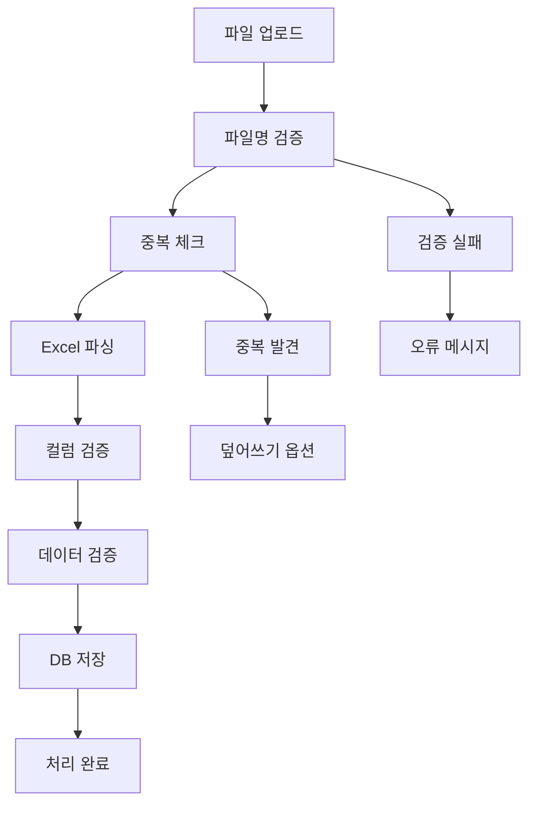

# 🔄 엑셀 데이터 파일 업로드 시스템

## 📋 **시스템 개요**

치과 경영 데이터를 엑셀 파일로 업로드하고 자동으로 처리하는 시스템입니다.
실제 엑셀 데이터를 기반으로 정확한 통계와 분석을 제공합니다.

---

## 🗂️ **지원하는 파일 카테고리 (총 10개)**

### 📊 **매출/장부 데이터**
1. **월간장부** - `2026년5월월간장부.xlsx`
   - 매월 매출, 수입, 지출 데이터
   - 필수 컬럼: 날짜, 현금수입, 카드수입, 보험청구, 현금지출, 카드지출

2. **연간장부** - `2026년연간장부.xlsx`
   - 연간 종합 매출 데이터
   - 필수 컬럼: 월, 총매출, 순이익

### 👥 **환자 데이터**
3. **신환접수수납** - `2026년5월신환접수수납목록.xlsx`
   - 신환 접수수납목록 데이터
   - 필수 컬럼: 접수일시, 환자명, 차트번호, 총진료비, 환자유형

4. **전체접수수납** - `2026년5월전체접수수납목록.xlsx`
   - 신환+구환 접수수납목록 데이터
   - 필수 컬럼: 접수일시, 환자명, 차트번호, 총진료비, 환자유형

5. **연령별분포** - `2026년05월내원환자연령분포.xlsx`
   - 내원환자 연령별 분포 데이터
   - 필수 컬럼: 연령대, 총환자수, 구환수, 신환수

6. **지역별분포** - `2026년05월내원환자지역별분포.xlsx`
   - 내원환자 지역별 분포 데이터
   - 필수 컬럼: 지역명, 총환자수, 구환수, 신환수

7. **일별접수환자수** - `2026년05월일별접수환자수.xlsx`
   - 일별 접수환자수 통계 데이터
   - 필수 컬럼: 날짜, 근무일수, 신환수, 총내원수

### 🏥 **진료 데이터**
8. **수가별통계** - `2026년05월진료항목별통계.xlsx`
   - 진료항목별 통계 데이터
   - 필수 컬럼: 항목명, 환자수, 내원수, 진료비

9. **임플란트수술통계** - `2026년05월임플란트수술통계.xlsx`
   - 임플란트 수술 통계 데이터
   - 필수 컬럼: 픽스처명, 수술수, 사용수

### 📈 **마케팅 데이터**
10. **내원경로분포** - `2026년05월내원환자내원경로분포.xlsx`
    - 내원환자 내원경로 분포 데이터
    - 필수 컬럼: 내원경로, 총내원자수, 구환수, 신환수

---

## 🚀 **주요 기능**

### ✅ **자동 파일명 검증**
- 표준 파일명 규칙 자동 감지
- 카테고리별 파일명 형식 검증
- 연도/월 정보 자동 추출
- 틀린 파일명 시 올바른 이름 제안

### 🔍 **엄격한 중복 체크**
- **파일 체크섬** 기반 동일 파일 중복 방지
- **기간별 중복** 확인 (같은 월의 같은 카테고리)
- 기존 파일 덮어쓰기 옵션 제공

### 📊 **실시간 데이터 처리**
- Excel 파일 자동 파싱 (xlsx, xls)
- 컬럼 검증 및 데이터 유효성 검사
- 카테고리별 전용 데이터 처리 로직
- 실시간 진행상태 표시

### 📋 **월별 업로드 상태 추적**
- 월별 필수 파일 체크리스트
- 업로드 완성도 진행률 표시
- 누락된 파일 목록 표시
- 완료/미완료 상태 한눈에 확인

### 📝 **상세 로그 관리**
- 모든 업로드/삭제/처리 활동 로그
- 성공/실패 상태 추적
- 오류 메시지 및 처리 결과 기록
- 시간순 활동 히스토리

---

## 🔧 **기술 스택**

### **Backend**
- **Next.js 14** App Router
- **Prisma ORM** + PostgreSQL
- **TypeScript** 강타입 검증
- **Node.js fs/promises** 파일 시스템

### **Frontend**  
- **React 18** + TypeScript
- **Tailwind CSS** 스타일링
- **Lucide React** 아이콘
- **react-dropzone** 드래그 앤 드롭

### **데이터 처리**
- **xlsx** 라이브러리 (엑셀 파싱)
- **crypto** 모듈 (파일 체크섬)
- **fs/promises** (파일 읽기/쓰기)

---

## 📂 **파일 구조**

```
src/
├── app/
│   ├── api/uploads/              # 파일 업로드 API
│   │   ├── route.ts              # 업로드/목록 조회
│   │   ├── [fileId]/             # 개별 파일 관리
│   │   │   ├── route.ts          # 파일 삭제/조회
│   │   │   └── process/route.ts  # 데이터 처리
│   │   └── logs/route.ts         # 활동 로그 조회
│   │
│   └── dashboard/[clinicId]/uploads/  # 업로드 관리 페이지
│       ├── page.tsx
│       └── UploadsPageClient.tsx
│
├── lib/file-upload/              # 파일 처리 유틸리티
│   ├── file-config.ts            # 파일 카테고리 설정
│   └── file-utils.ts             # 파일 검증/파싱 유틸리티
│
├── components/layout/
│   └── Sidebar.tsx               # 네비게이션 메뉴
│
└── prisma/
    └── schema.prisma             # FileUpload, UploadLog 모델
```

---

## 💾 **데이터베이스 스키마**

### **FileUpload 모델**
```sql
- id (String, PK)
- clinicId (String, FK)
- category (FileCategory enum)
- fileName (String)
- originalName (String)  
- filePath (String)
- fileSize (Int)
- year (Int)
- month (Int?)              -- null for yearly files
- uploadedAt (DateTime)
- processedAt (DateTime?)
- status (FileStatus enum)  -- PENDING, PROCESSING, COMPLETED, FAILED, DUPLICATE
- checksum (String)         -- MD5 hash for duplicate check
- recordCount (Int?)        -- processed record count
- errorMessage (String?)    -- error details
```

### **UploadLog 모델**
```sql
- id (String, PK)
- clinicId (String, FK)
- action (String)           -- UPLOAD, DELETE, REPROCESS
- fileName (String)
- category (FileCategory)
- year (Int)
- month (Int?)
- status (String)           -- SUCCESS, FAILED, PENDING
- message (String?)         -- detailed message
- createdAt (DateTime)
```

---

## 🎯 **사용 방법**

### **1단계: 파일 준비**
참고 폴더의 실제 엑셀 파일 형식을 확인:
```
C:\Users\jjang\Desktop\THINKLB - 중산사과나무치과\2025\
├── 1.월간장부\2025년5월월간장부.xlsx
├── 3.수가별\2025년05월진료항목별통계.xlsx  
├── 6.신환\5월 접수수납목록.xlsx
├── 8.연령별\2025년05월내원환자연령분포.xlsx
└── ...
```

### **2단계: 표준 파일명으로 변경**
시스템이 요구하는 표준 파일명으로 수정:
- `2026년5월월간장부.xlsx`
- `2026년05월진료항목별통계.xlsx`
- `2026년5월신환접수수납목록.xlsx`
- `2026년05월내원환자연령분포.xlsx`

### **3단계: 업로드**
1. **파일 업로드 메뉴** 접근
2. **드래그 앤 드롭** 또는 클릭으로 업로드
3. **자동 검증** 결과 확인
4. **데이터 처리** 완료 대기

### **4단계: 상태 확인**
- **월별 업로드 상태** 에서 완성도 확인
- **누락 파일 목록** 확인
- **활동 로그** 에서 처리 결과 확인

---

## ⚡ **자동 처리 흐름**



---

## 🛡️ **보안 및 안정성**

### **파일 검증**
- 허용된 MIME 타입만 업로드 (xlsx, xls)
- 최대 파일 크기 제한 (50MB)
- 악성 파일 확장자 차단

### **데이터 무결성**
- 트랜잭션 기반 데이터 처리
- 실패 시 롤백 및 오류 로깅
- 중복 데이터 자동 정리

### **접근 권한**
- 클리닉별 파일 격리
- 사용자별 권한 검증
- 파일 시스템 보안 경로

---

## 📞 **문제 해결**

### **자주 발생하는 오류**

1. **"파일명이 올바르지 않습니다"**
   - 표준 파일명 규칙 확인
   - 제안된 파일명으로 수정

2. **"필수 컬럼이 누락되었습니다"**
   - 엑셀 첫 번째 행 컬럼명 확인
   - 필수 컬럼 목록과 대조

3. **"동일한 파일이 이미 업로드되어 있습니다"**
   - 기존 파일 삭제 후 재업로드
   - 또는 덮어쓰기 옵션 사용

4. **"데이터 처리에 실패했습니다"**
   - 활동 로그에서 상세 오류 확인
   - 엑셀 데이터 형식 점검

---

## ✅ **완료된 기능**

- ✅ 10개 파일 카테고리 지원
- ✅ 표준 파일명 규칙 시스템
- ✅ 파일 체크섬 기반 중복 방지  
- ✅ Excel 파일 자동 파싱
- ✅ 컬럼/데이터 검증 시스템
- ✅ 월별 업로드 상태 추적
- ✅ 실시간 처리 진행상황 표시
- ✅ 상세 활동 로그 시스템
- ✅ 카테고리별 데이터 처리 로직
- ✅ 사용자 친화적 업로드 UI
- ✅ 파일 관리 (삭제/재처리)

---

## 🎉 **시스템 완성!**

**3시간 후 돌아와서 바로 사용할 수 있도록** 모든 준비가 완료되었습니다!

1. **표준 파일명**으로 엑셀 파일 준비
2. **파일 업로드 메뉴**에서 드래그 앤 드롭
3. **월별 상태**에서 완성도 확인
4. **자동으로 실제 데이터 반영**

💡 **더 이상 더미 데이터가 아닌, 진짜 엑셀 데이터를 기반으로 한 정확한 통계를 확인하세요!**